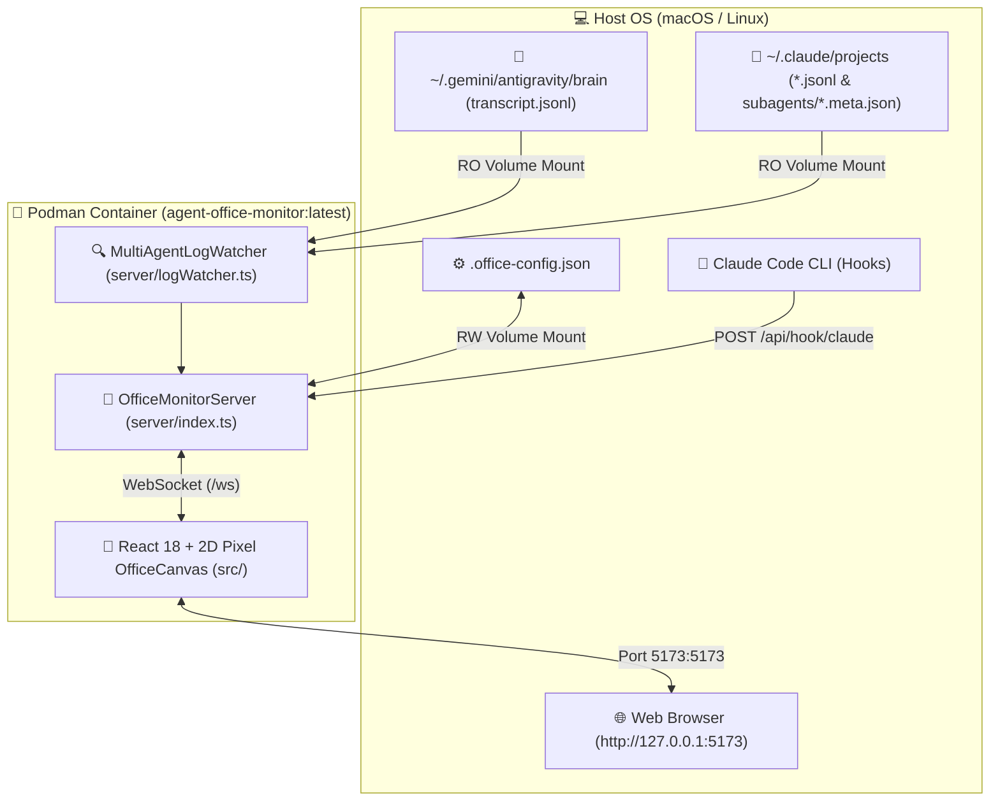

# 🏢 Agent Office Monitor

**Antigravity**와 **Claude Code** 멀티 에이전트 세션 및 서브에이전트의 실시간 작업 상태를 한눈에 모니터링할 수 있는 **2D 픽셀 아트 가상 오피스 대시보드**입니다.

---

## 🎯 프로젝트 개요

### 1. 어떤 문제를 해결하고자 했나요?
여러 개의 AI 코딩 에이전트(**Antigravity**, **Claude Code**)와 서브에이전트를 동시에 띄워 작업할 때, 터미널 창이 분산되어 **"지금 어느 에이전트가 코딩 중이고, 누가 내 응답을 기다리며 멈춰 있는지"** 한눈에 파악하기 어려운 가시성(Observability) 문제를 해결하고자 했습니다.

### 2. 어떤 서비스를 만들었나요?
로컬의 **Antigravity(`~/.gemini/antigravity/brain`)**와 **Claude Code(`~/.claude/projects` 및 실시간 Hook)** 로그를 실시간으로 감지하여, 좌측 **Antigravity 오피스**·중앙 **공용 휴게실(`☕ SHARED LOUNGE`)**·우측 **Claude Code 오피스**로 구성된 **2D 픽셀 아트 가상 사무실 대시보드**를 만들었습니다.

### 3. 주요 기능
- **실시간 3구역 듀얼 오피스**:
  - 🟡 **좌측 Antigravity Office**: Antigravity 메인 세션 및 서브에이전트 전용 데스크 (`AGY-1` ~ `AGY-6`)
  - ☕ **중앙 Shared Lounge**: 작업 완료 후 대기 중인 서브에이전트 및 유휴 에이전트들이 쉬는 공용 휴게실
  - 🟠 **우측 Claude Code Office**: Claude Code 메인 세션 및 서브에이전트 전용 데스크 (`CLD-1` ~ `CLD-6`)
- **세션/서브에이전트 실명 연동**:
  - Claude Code의 `customTitle`, `agentName`, 서브에이전트 `agent-*.meta.json` (`agentType`) 및 Antigravity의 `invoke_subagent` (`Role`, `TypeName`)를 파싱하여 실제 정의된 에이전트 이름을 그대로 표시합니다.
- **생동감 있는 픽셀 애니메이션**:
  - **출근 모션 (`CLOCK-IN`)**: 출입문(`AGY DOOR` / `CLAUDE DOOR`)에서 웰컴 링 이펙트와 함께 손을 흔들며 인사 후 데스크로 이동
  - **통로 경유 이동**: 사무실과 중앙 휴게실 사이 이동 시 파티션 중앙의 아치형 통로를 자연스럽게 통과
  - **휴게실 6종 대기 모션 (`IDLE_LOUNGE`)**: 커피 내리기(`☕`), 정수기 물 마시기(`💧`), 소파 휴식(`🛋️`), 동료와 담소/음악 감상(`💬`/`🎵`), 스트레칭(`🙆`), 기술 문서 열람(`📱`) 및 라운지 내 자율 산책
  - **퇴근 모션 (`CLOCK-OUT`)**: 세션 종료 시 출입문까지 걸어가 작별 인사를 건네며 페이드아웃
- **실시간 인스펙터 & 액티비티 피드**:
  - 캐릭터 클릭 시 현재 실행 중인 도구(`Read`, `Edit`, `Bash`, `run_command` 등), 추론 내용, 누적 입출력 토큰(k) 및 스텝 수를 실시간 표시

---

## 🏗️ 아키텍처 다이어그램

상세 아키텍처 문서: [`docs/architecture.md`](docs/architecture.md) · 시각적 구조도 및 실행 화면 프리뷰: [`agent-office-overview.html`](agent-office-overview.html)



---

## 🚀 실행 방법

### 1. Podman 컨테이너로 실행 (권장)

호스트의 `~/.gemini/antigravity/brain`과 `~/.claude/projects`를 읽기 전용(`:ro`) 볼륨으로 마운트하여 컨테이너로 실행합니다.

```bash
# 이미지 빌드 및 컨테이너 시작 (코드 변경 시 --build 옵션 포함)
./start.sh --build

# 컨테이너 상태 확인
./office-monitor.sh status

# 실시간 컨테이너 로그 확인
./office-monitor.sh logs

# 컨테이너 종료
./stop.sh
```

브라우저에서 **`http://127.0.0.1:5173`** 으로 접속합니다.

### 2. 로컬 Node.js 환경에서 직접 실행

```bash
npm install
npm run dev
```

---

## 📂 디렉터리 구조

```text
├── Containerfile              # Podman / Docker 컨테이너 빌드 정의 (node:22-alpine)
├── office-monitor.sh          # Podman 컨테이너 빌드·시작·중지·상태·로그 통합 스크립트
├── start.sh                   # 컨테이너 시작 단축 스크립트
├── stop.sh                    # 컨테이너 종료 단축 스크립트
├── agent-office-overview.html # 서비스 아키텍처 구조도 및 실행 화면 프리뷰 HTML 문서
├── docs/
│   └── architecture.md        # 상세 Mermaid 아키텍처 다이어그램 문서
├── server/
│   ├── index.ts               # WebSocket(/ws) & REST API 서버 및 오피스별 좌석 배정
│   ├── logWatcher.ts          # Antigravity & Claude Code JSONL 실시간 파서
│   ├── simulator.ts           # 가상 에이전트 출퇴근 시뮬레이터
│   └── types.ts               # 서버-클라이언트 공용 타입 정의
└── src/
    ├── App.tsx                # 상단 HUD, 캔버스, 우측 인스펙터 레이아웃
    ├── components/
    │   ├── OfficeCanvas.tsx   # 60fps 2D 캔버스 루프, 출퇴근·휴게실 모션 및 통로 라우팅
    │   ├── pixelSprites.ts    # 3구역 오피스 배경, 워크스테이션, 픽셀 캐릭터 렌더러
    │   ├── AgentDetail.tsx    # 선택된 에이전트 상세 인스펙터 카드
    │   ├── ActivityFeed.tsx   # 실시간 도구 호출 액티비티 피드
    │   └── SettingsModal.tsx  # 경로·휴게실/퇴근 타이머·Claude Hook 연동 설정 모달
    └── hooks/
        └── useAgentSocket.ts  # WebSocket 실시간 동기화 및 재연결 훅
```
