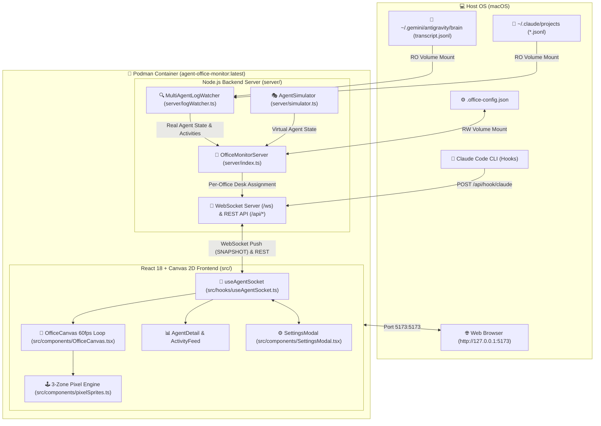
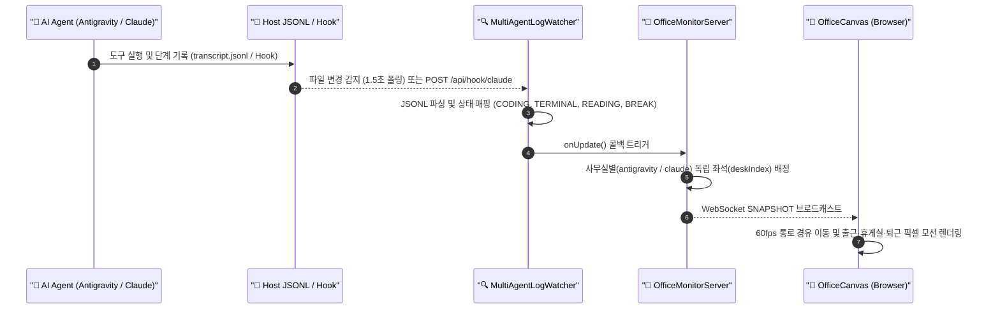
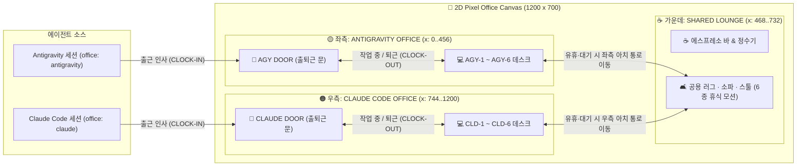

# Agent Office Monitor 아키텍처 다이어그램

## 1. 전체 시스템 & Podman 컨테이너 아키텍처

호스트 OS(macOS)의 로컬 에이전트 로그 디렉터리와 Claude Code Hook 이벤트가 Podman 컨테이너 내부의 백엔드([`OfficeMonitorServer`](../server/index.ts))를 거쳐 React 2D 픽셀 캔버스([`OfficeCanvas.tsx`](../src/components/OfficeCanvas.tsx))로 전달되는 전체 구조입니다.

---

## 2. 실시간 로그 감지 및 WebSocket 브로드캐스트 시퀀스

에이전트가 도구를 호출(`edit_file`, `run_command`, `Read`, `Bash` 등)하거나 생각을 기록할 때 화면의 캐릭터가 실시간으로 움직이고 말풍선이 갱신되는 흐름입니다.

---

## 3. 3구역 오피스 공간 배정 및 상태 전환 구조

[`OfficeMonitorServer.buildSnapshot()`](../server/index.ts)과 [`OfficeCanvas.tsx`](../src/components/OfficeCanvas.tsx)가 에이전트의 소속(`office`)과 현재 상태(`status`)에 따라 1200×700 캔버스 위 좌표를 결정하는 구조입니다.

---

## 4. 주요 컴포넌트 및 파일 매핑

| 계층 | 파일 | 역할 |
| :--- | :--- | :--- |
| **Container / Infra** | [`Containerfile`](../Containerfile), [`office-monitor.sh`](../office-monitor.sh) | `node:22-alpine` 이미지 빌드, 호스트 로그 볼륨(`:ro`) 마운트 및 컨테이너 라이프사이클 관리 |
| **Backend Core** | [`server/index.ts`](../server/index.ts) | WebSocket(`/ws`) 브로드캐스트, REST API(`/api/*`), 사무실별 독립 좌석 배정 |
| **Log Watcher** | [`server/logWatcher.ts`](../server/logWatcher.ts) | Antigravity(`transcript.jsonl`) 및 Claude Code(`~/.claude/projects`) 실시간 파싱, 세션/서브에이전트 실명 추출, Hook 수신 |
| **Simulator** | [`server/simulator.ts`](../server/simulator.ts) | `+ AGY 출근` / `+ Claude 출근` 수동 테스트용 가상 에이전트 상태 시뮬레이션 |
| **2D Canvas & Sprites** | [`src/components/OfficeCanvas.tsx`](../src/components/OfficeCanvas.tsx), [`src/components/pixelSprites.ts`](../src/components/pixelSprites.ts) | 1200×700 3구역 오피스 렌더링, 출근·휴게실(6종)·퇴근 모션, 아치 통로 경유 이동, 말풍선 오버레이 |
| **Telemetry & Config** | [`src/components/AgentDetail.tsx`](../src/components/AgentDetail.tsx), [`src/components/ActivityFeed.tsx`](../src/components/ActivityFeed.tsx), [`src/components/SettingsModal.tsx`](../src/components/SettingsModal.tsx) | 에이전트 상세 인스펙터, 실시간 작업 로그 피드, 경로/타이머/Hook 연동 설정 모달 |
